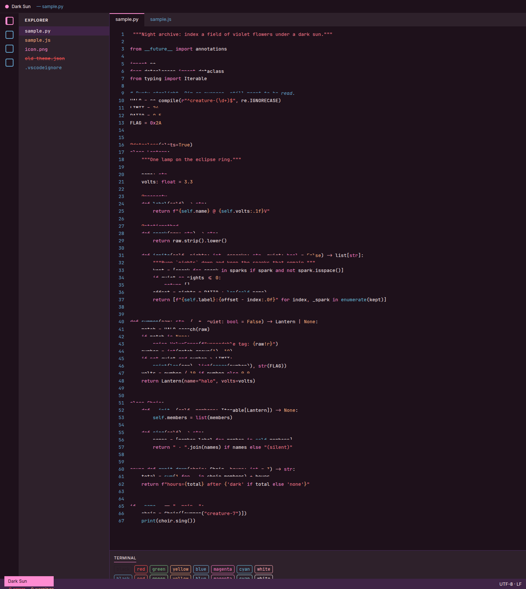
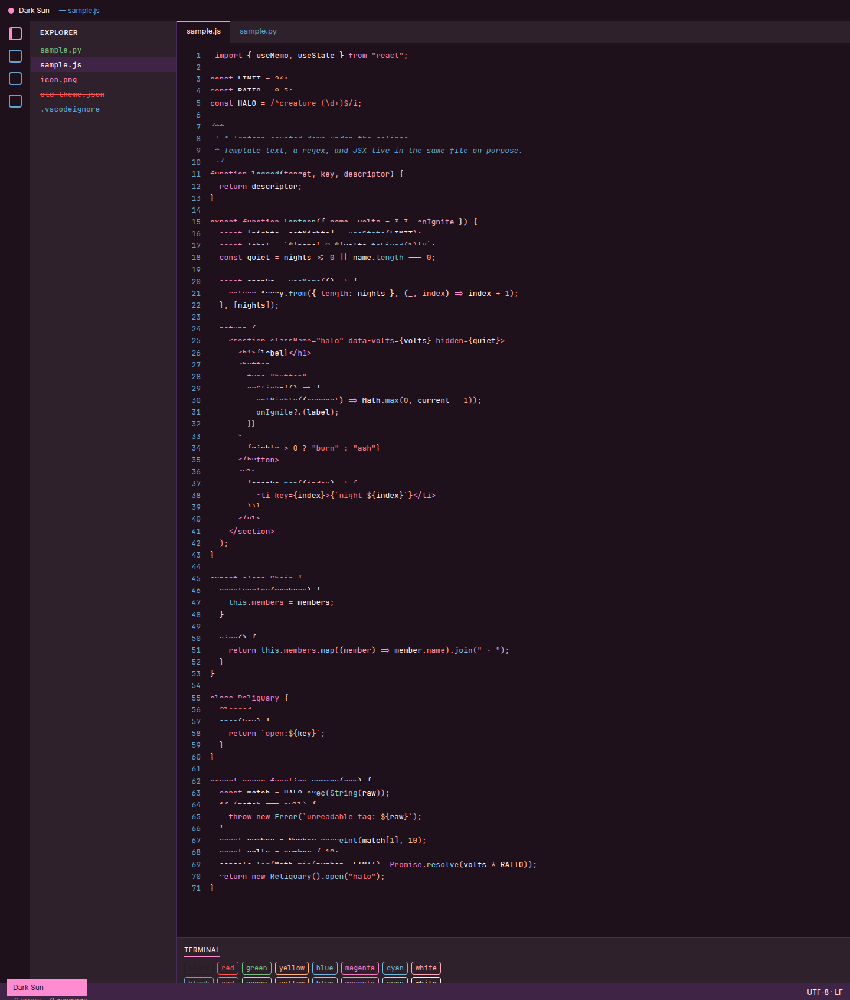
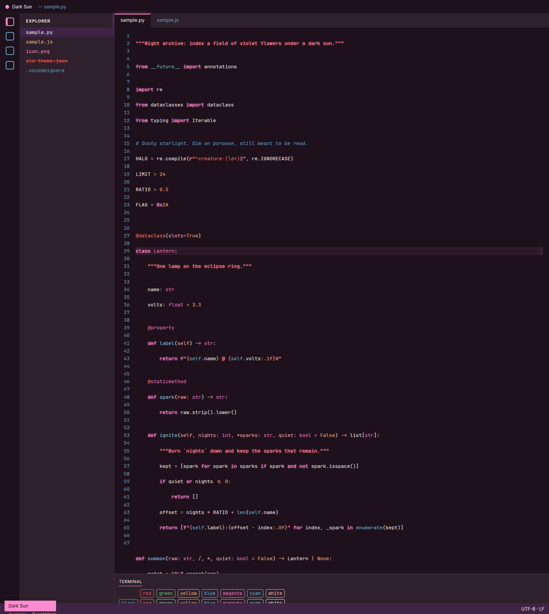
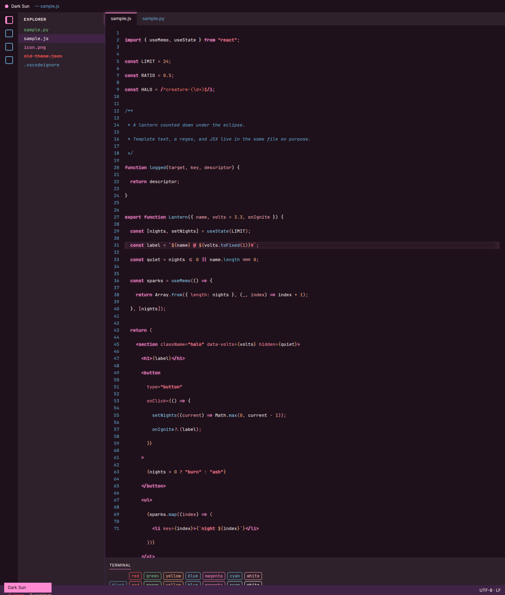
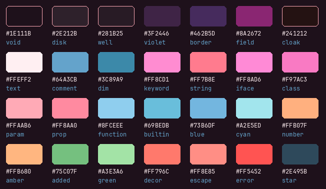

# Dark Sun

A dark-only VS Code theme sampled from the official covers of Dayseeker's *Dark Sun* (Spinefarm, November 4, 2022) and *Creature in the Black Night* (Spinefarm, October 24, 2025; art direction and design by Ryan Sanders). The editor is the eclipse: purple and pink neon, a little red, and blue on near-black.





The previews above are the theme with the glow off. The same render with the optional glow on:





These are rendered from `themes/dark-sun-color-theme.json` with TextMate grammars (Shiki) and this theme's workbench colors. `sample.py` and `sample.js` are the sources. The glow shots add the same text-shadow and tab bloom as `styles/neon-glow.js`.

## Install

From a packaged extension:

```bash
npx @vscode/vsce package
code --install-extension dayseeker-theme-1.1.0.vsix
```

Then choose **Dark Sun** in the Color Theme picker. There is no light variant. Neon glow stays off until you turn it on.

## Neon glow

VS Code color themes cannot set `text-shadow`. Synthwave '84 patches VS Code's own install from an **Enable Neon Dreams** command. Custom CSS and JS Loader (`be5invis.vscode-custom-css`) does the same kind of injection, but the patch lives in that extension instead of this one. Dark Sun uses the loader. With the glow off, the theme looks and behaves exactly as the color theme alone.

The glow is a short halo on keywords and strings, plus a soft bloom on the active tab and the cursor line. Other themes are left alone: the script only paints while the editor background is Dark Sun's `#1E111B`.

### Enable

1. Install [Custom CSS and JS Loader](https://marketplace.visualstudio.com/items?itemName=be5invis.vscode-custom-css).
2. Run **Dark Sun: Enable Neon Glow**. That adds this extension's `styles/neon-glow.js` to `vscode_custom_css.imports`. On Windows and Linux the loader needs permission to modify the VS Code install. See that extension's readme.
3. Run **Enable Custom CSS and JS**, then reload VS Code.

You can do step 2 by hand. The import has to be a `file://` URL, not a plain path:

```json
"vscode_custom_css.imports": [
  "file:///absolute/path/to/styles/neon-glow.js"
]
```

After a VS Code update, run **Enable Custom CSS and JS** again. The loader's injection is cleared by updates.

### Disable

1. Run **Dark Sun: Disable Neon Glow**. That removes the glow file from `vscode_custom_css.imports`.
2. If the glow was the only custom import, run **Disable Custom CSS and JS** and reload. That restores VS Code's original workbench files.
3. If you still load other CSS or JS, run **Reload Custom CSS and JS** instead. The glow drops and the other files stay.

### The corrupt-installation warning

Enabling the loader rewrites a VS Code workbench file, so VS Code reports that the installation appears to be corrupt and may show **[Unsupported]** in the title bar. That warning is expected. You can dismiss it. [Fix VSCode Checksums](https://marketplace.visualstudio.com/items?itemName=lehni.vscode-fix-checksums) (`Fix Checksums: Apply`, then a full restart) hides the badge. Disabling the loader and reloading is what actually removes the injection.

## Palette

The swatches start from pixels on the 2000×2000 Apple Music masters of the two covers. A few surfaces are the nearest real pixel to a regional median, at most one RGB level away. Purples, pinks, magentas, blues, and the reds were then pushed a little more saturated. The eclipse backgrounds, the corona white, the amber ring, and the green ring stay on the sampled values. **Boosted from** names the sampled hex. A dash means the shipped color is the sample.



| Hex | Boosted from | Album | Where it comes from | Used for |
| --- | --- | --- | --- | --- |
| `#1E111B` | — | Dark Sun | Eclipse core | Editor, terminal, activity bar, and title bar background |
| `#2E212B` | — | Dark Sun | Eclipse disk, nearest pixel to the disk median `#2E202B` | Sidebar, panel, and inactive tabs |
| `#281B25` | — | Dark Sun | Inner disk shadow, nearest pixel to the dark-fifth median `#281A25` | Inputs, line highlight, suggest and hover wells |
| `#2E495B` | `#374D5B` | Dark Sun | Outer starfield, nearest pixel to the corner median `#374C5B` | List hover, indent guides, chart lines |
| `#3C89A9` | `#54879C` | Dark Sun | Muted blue in the outer ring | Dimmed line numbers |
| `#64A3CB` | `#79A1BA` | Dark Sun | Dusty starfield blue, nearest pixel to `#79A0BA` | Comments, line numbers, inactive activity-bar icons, git ignored |
| `#73B6DF` | `#83B4D2` | Dark Sun | Blue ring | Terminal blue |
| `#69BEDB` | `#7EBBD0` | Dark Sun | Cyan-blue ring | Builtins (`print`, `len`, `self`), terminal cyan |
| `#8FCEEE` | `#9ECCE4` | Dark Sun | Bright blue ring | Functions, methods, links, info |
| `#A2E5ED` | `#AEE3E9` | Dark Sun | Brightest cyan edge of the ring | Terminal bright cyan, active links |
| `#FFEFF2` | — | Dark Sun | Corona / star white | Primary editor and UI text |
| `#FFAAB6` | `#F7B1BB` | Dark Sun | Pale pink ring | Parameters, operators, punctuation |
| `#FF8AA0` | `#F398A9` | Dark Sun | Rose ring | Properties, JSX attributes, JSON keys |
| `#FF7B8E` | `#FF8F9F` | Dark Sun | Hot pink ring | Strings, including quotes. Neon glow target |
| `#FF8CD1` | `#FFA5DB` | Dark Sun | Magenta ring | Keywords, imports, JSX tags, focus, buttons, tab accent. Neon glow target |
| `#FF8AD6` | `#F49BD5` | Dark Sun | Orchid ring | Interfaces and type aliases |
| `#F97AC3` | `#E389BD` | Dark Sun | Mid magenta ring | Classes, types, terminal magenta |
| `#FFB07F` | — | Dark Sun | Amber ring | Numbers, constants, warnings, git modified |
| `#FFB680` | — | Dark Sun | Brighter amber on the same ring | Terminal bright yellow |
| `#75C07F` | — | Dark Sun | Green ring along the bottom of the eclipse | Git added, diff insertions, terminal green |
| `#A3E3A6` | — | Dark Sun | Bright green on that ring | Terminal bright green |
| `#3F2446` | `#412D46` | Creature in the Black Night | Violet foreground, nearest pixel to `#412C46` | Selection, status bar, active lists |
| `#462B5D` | `#4B365D` | Creature in the Black Night | Violet field, nearest pixel to `#4B355D` | Borders, scrollbars, widget outlines |
| `#8A2672` | `#8A3876` | Creature in the Black Night | Magenta flower field, nearest pixel to the field median `#8B3876` | Debugging status bar, incoming merge header |
| `#241212` | — | Creature in the Black Night | The figure's cloak | Error input background |
| `#FF796C` | `#FF877C` | Creature in the Black Night | Coral peak in the sky | Decorators and regex, the one warm token class; terminal bright red |
| `#FF8E85` | `#FB968E` | Creature in the Black Night | Coral sky | String escapes |
| `#FF5452` | `#F95355` | Creature in the Black Night | Red along the lower sky | Errors, invalid tokens, git deletions, diff removals |

Red stays on errors and deletions. The coral `#FF796C` (sampled as `#FF877C`) is the only other warm token color, and it is limited to decorators and regular expressions. Green exists on the *Dark Sun* cover, so additions and terminal green do not have to be faked out of the pinks.

## Contrast

Checked by `scripts/check_theme.py` against WCAG:

- Editor text `#FFEFF2` on `#1E111B` is **16.40:1** (AAA).
- Comments `#64A3CB` are **6.64:1** on the editor and **4.92:1** on the violet selection (AA). They are dimmer than the code without dropping under AA.
- Token colors, the readable terminal ANSI colors, git decorations, and the main chrome pairs (sidebar, tabs, status bar, inputs, buttons, badges) are required to clear **4.5:1** on their own backgrounds.

ANSI black is `#281B25`, the same dark well as the inputs. It is a TUI background color, not body text, so the check only requires it to be a valid hex.

```bash
python3 scripts/check_theme.py
```

GitHub Actions runs that script on push and pull request.

## What's covered

Workbench colors include the editor, sidebar, activity bar, tabs, status bar, panels, terminal ANSI colors, git decorations, diffs, errors and warnings, and bracket-pair colors. TextMate rules plus `semanticTokenColors` cover keywords, strings, f-strings and template literals, numbers, comments, functions and methods, classes, decorators, parameters, properties, builtins, operators, regex, imports, and JSX. The generic scopes also color TypeScript, JSON, Markdown, and CSS.

Semantic highlighting and bracket-pair guides are on by default via `configurationDefaults`.

## License

[MIT](LICENSE) © 2026 AyAyRon
